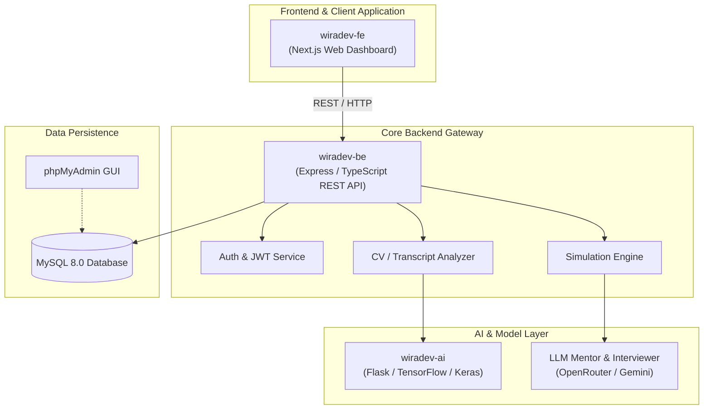

<p align="center">
  
</p>

# WiraDev - The Next-Generation Career & Talent Intelligence Ecosystem

> **One Main Ecosystem Orchestrating 3 Dedicated Micro-Repositories**  
> Developed for **UIN Information Competition (UINIC) 8.0 - Web Development Competition 2026**

---

## 📌 Executive Summary

**WiraDev** is an integrated AI-driven career acceleration and simulation platform designed to bridge the gap between job seekers and industry expectations. Through deep learning, automated CV and transcript screening, real-time interview simulations, and modern web accessibility, WiraDev empowers candidates to evaluate their skills and master modern recruitment pipelines.

This repository (**`WiraDev`**) serves as the **Main Orchestrator Repository** coordinating 3 specialized sub-repositories via **Git Submodules**:

| Service / Sub-repo | Description | Tech Stack | Repository Link |
| :--- | :--- | :--- | :--- |
| **`wiradev-fe`** | Web Dashboard & Interactive Simulation | Next.js 15, React 19, TypeScript, Tailwind | [GitHub: wiradev-fe](https://github.com/cipta77/wiradev-fe) |
| **`wiradev-be`** | REST API, Business Logic & DB Engine | Node.js, Express, TypeScript, MySQL | [GitHub: wiradev-be](https://github.com/cipta77/wiradev-be) |
| **`wiradev-ai`** | Deep Learning Inference & NLP Model | Python 3.10, Flask, TensorFlow, Keras, Git LFS | [GitHub: wiradev-ai](https://github.com/cipta77/wiradev-ai) |

---

## 🏛️ System Architecture



---

## 🚀 Quick Start Guide

### 1. Clone the Complete Ecosystem (Recursive Submodules)

To clone the main repository along with all 3 sub-repositories populated:

```bash
git clone --recurse-submodules https://github.com/cipta77/WiraDev.git
cd WiraDev
```

If you already cloned without `--recurse-submodules`, initialize them with:

```bash
./setup.sh
# or manually:
git submodule update --init --recursive
```

---

### 2. Run Entire Stack with Docker Compose

Ensure [Docker](https://www.docker.com/) and [Docker Compose](https://docs.docker.com/compose/) are installed, then run:

```bash
docker compose up --build
```

This automatically boots:
- **MySQL Database**: `localhost:3306`
- **phpMyAdmin**: `http://localhost:8080`
- **AI Microservice**: `http://localhost:7860`
- **Backend API**: `http://localhost:5000`
- **Web Frontend**: `http://localhost:3000`

---

## 📂 Sub-Repository Details & Local Development

### 1. `wiradev-fe` (Web Application)
Modern, accessible Next.js web application with dark-mode support, English interview simulation, and analytics.
```bash
cd wiradev-fe
pnpm install
pnpm run dev
```

### 2. `wiradev-be` (REST API Server)
Scalable TypeScript backend powering data synchronization, authentication, and Swagger API documentation.
```bash
cd wiradev-be
pnpm install
pnpm run dev
```

### 3. `wiradev-ai` (AI Inference Service)
Machine learning service hosting deep learning models for classification, candidate scoring, and transcript intelligence.
```bash
cd wiradev-ai
pip install -r requirements.txt
python app.py
```

---

## 🔗 Direct Repository Links

- **Main Repository**: [https://github.com/cipta77/WiraDev](https://github.com/cipta77/WiraDev)
- **Frontend Sub-repo**: [https://github.com/cipta77/wiradev-fe](https://github.com/cipta77/wiradev-fe)
- **Backend Sub-repo**: [https://github.com/cipta77/wiradev-be](https://github.com/cipta77/wiradev-be)
- **AI Sub-repo**: [https://github.com/cipta77/wiradev-ai](https://github.com/cipta77/wiradev-ai)

---

## 📄 License & Attribution

Developed with ❤️ for **UINIC 8.0 2026 Web Development Competition**.  
All rights reserved © 2026 WiraDev Team.
